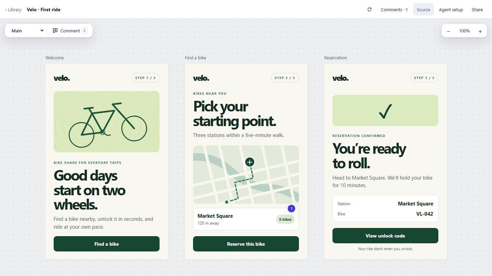
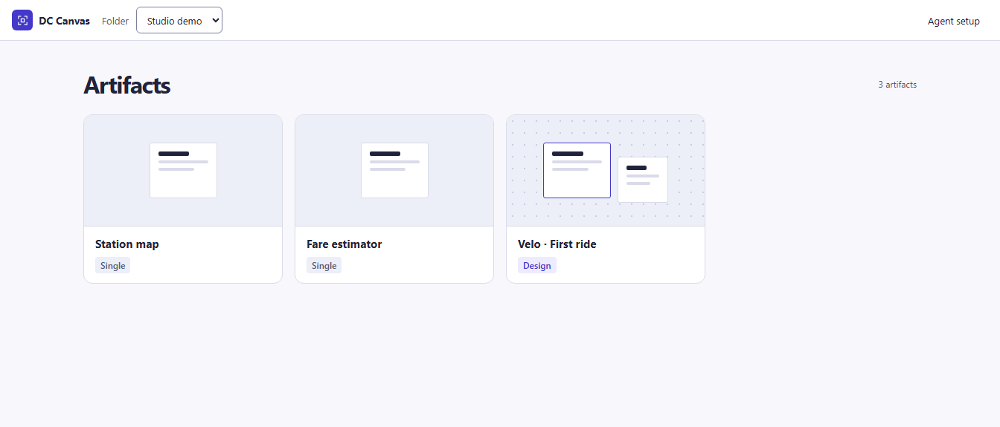

# Codex Artifacts

Codex Artifacts is an independent port of the Claude Artifacts workflow for Codex. Ask Codex for an interactive prototype, open it in your browser, and iterate on the same artifact from chat. DC Canvas is the local editor and renderer that powers the plugin. The project currently focuses on interactive HTML prototypes and design canvases. [Claude Artifacts](https://support.claude.com/en/articles/17153992-what-are-artifacts-and-how-do-i-use-them)



## Install in Codex

Install Node.js 20 or newer and make sure the Codex desktop app can find `node` on its `PATH`.

```sh
codex plugin marketplace add boramuyar/codex-artifacts
codex plugin add dc-canvas@codex-artifacts
```

You can also install **Codex Artifacts** from the **Codex Artifacts** marketplace in the desktop Plugins directory. Restart the app if the marketplace does not appear, then open a new chat in your project.

> Use DC Canvas to prototype a two-step signup flow. Put both screens on one canvas and give me a browser link.

## What you can make

- **Design canvas** for related screens and states. Organize boards into pages, pan across the canvas, and try the interactions inside each board.
- **Single artifact** for a calculator, dashboard, or other interactive page with a minimal viewer.
- **Feedback in context.** Press **C** to pin a comment to a board, or open **Comments** to review existing notes. Ask Codex to revise the boards from that feedback.
- **Portable HTML.** Use **Share** to download a board, page, or full canvas. Exports embed the renderer and referenced local assets.

The browser library groups artifacts by project. The plugin stores them under `~/.dc-canvas/library`. Live browser links open on the machine running the MCP session. Share the exported HTML when you want someone else to open the result.



## Run from source

```sh
git clone https://github.com/boramuyar/codex-artifacts.git
cd codex-artifacts
node bin/dc-canvas.mjs serve
```

Open the local library and use **Agent setup** to connect an MCP client. The CLI and server share the same library. [Open the local library](http://127.0.0.1:4173/)

```sh
node bin/dc-canvas.mjs tools
node bin/dc-canvas.mjs tool artifact_list
node bin/dc-canvas.mjs mcp
npm test
```

The CLI defaults to `./library` and groups artifacts by working directory. Pass `--library` to share a library between commands and `--origin` to select a project by absolute path. Use `--project` with `serve`, `mcp`, or `tool` to work directly on a standalone canvas.

Docker users can run `docker compose up --build -d`. Compose persists the library in a named volume and binds the viewer to localhost. Set `DC_CANVAS_PORT` to change the port or `DC_CANVAS_ORIGIN` to set the project label.

## Contribute

The authoring skill is plain Markdown. Edit it to change how Codex creates, revises, and shares boards. The contributor guide covers testing your changes in a local Codex install. [Edit the skill](skills/dc-canvas/SKILL.md) · [Contributor guide](CONTRIBUTING.md)

Boards are `.dc.html` files with template markup, JavaScript, and optional props. The authoring guide documents the board format, placement, and assets. MCP clients can also read it at `dc-canvas://guide`. [Authoring guide](GUIDE.md)

## License

MIT. [License text](LICENSE)
